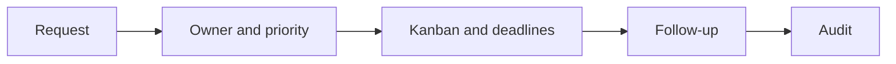

# Request Management Portal

A request-tracking application with ownership, Kanban workflow, deadlines and audit views.

**PHP, Laravel, Blade, Tailwind CSS, Vite**

## What it does

- Registers requests and responsible users.
- Organizes workflow with Kanban, priorities and deadlines.
- Provides follow-up and audit-log views.

## Workflow



## Local setup and use

Requires the PHP version declared in `composer.json`, Composer, Node.js and a separate local database.
```powershell
composer install
Copy-Item .env.example .env
php artisan key:generate
npm ci
npm run build
```
Configure a new local database before running `php artisan migrate`. Then run `php artisan serve` and `npm run dev` in separate terminals. `php artisan test` runs the PHP suite. The `composer setup` script also migrates a database; inspect its target before using it.

## Configuration

Environment names declared by the included examples (values must be supplied locally):

`APP_DEBUG`, `APP_ENV`, `APP_FAKER_LOCALE`, `APP_FALLBACK_LOCALE`, `APP_KEY`, `APP_LOCALE`, `APP_MAINTENANCE_DRIVER`, `APP_NAME`, `APP_TIMEZONE`, `APP_URL`, `AWS_ACCESS_KEY_ID`, `AWS_BUCKET`, `AWS_DEFAULT_REGION`, `AWS_SECRET_ACCESS_KEY`, `AWS_USE_PATH_STYLE_ENDPOINT`, `BCRYPT_ROUNDS`, `BROADCAST_CONNECTION`, `CACHE_STORE`, `DB_CONNECTION`, `FILESYSTEM_DISK`, `INITIAL_RESOURCE_EMAIL`, `INITIAL_RESOURCE_NAME`, `INITIAL_RESOURCE_PASSWORD`, `LOG_CHANNEL`, `LOG_DEPRECATIONS_CHANNEL`, `LOG_LEVEL`, `LOG_STACK`, `MAIL_FROM_ADDRESS`, `MAIL_FROM_NAME`, `MAIL_HOST`, `MAIL_MAILER`, `MAIL_PASSWORD`, `MAIL_PORT`, `MAIL_SCHEME`, `MAIL_USERNAME`, `MEMCACHED_HOST`, `QUEUE_CONNECTION`, `REDIS_CLIENT`, `REDIS_HOST`, `REDIS_PASSWORD`, `REDIS_PORT`, `SESSION_DOMAIN`, `SESSION_DRIVER`, `SESSION_ENCRYPT`, `SESSION_LIFETIME`, `SESSION_PATH`, `VITE_APP_NAME`.

## Boundaries and limitations

No users, database or operational records are bundled. PHP/Composer and a configured database are required for backend execution; a frontend build alone does not verify Laravel behavior.

This is a source snapshot, not a claim of production readiness. Business results, dates and unmeasured performance are intentionally not asserted. Application UI language is preserved.

## License

No new distribution license is granted for this corporate source edition. Public visibility does not grant reuse rights; obtain permission from the relevant rights holder. Existing third-party notices remain applicable.

## Verification record

See [snapshot checks and remaining limitations](docs/VERIFICATION.md).
